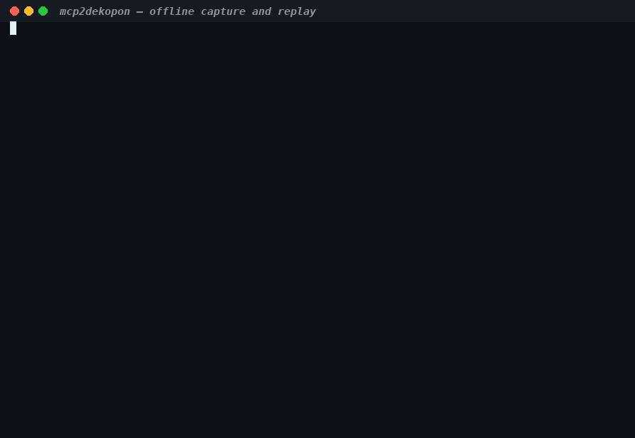
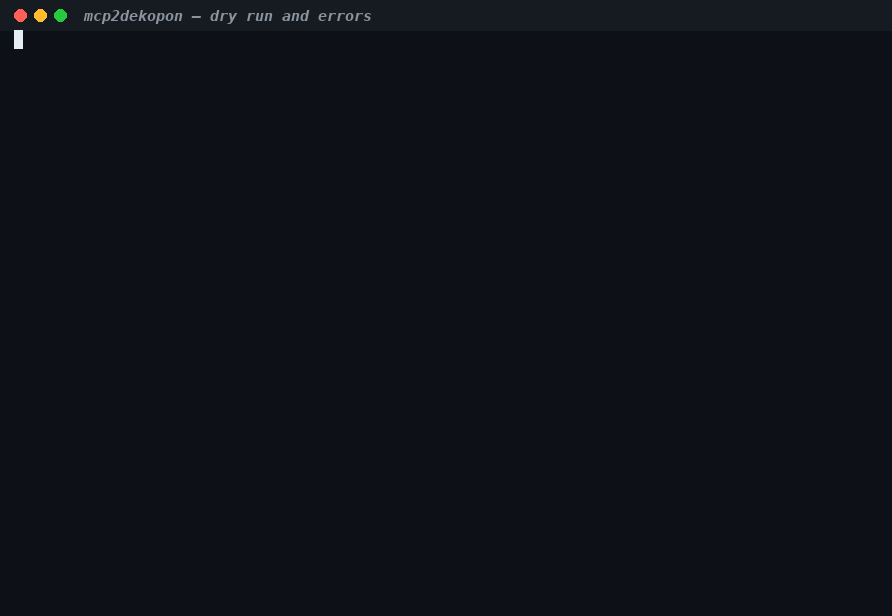

# mcp2dekopon

Generate [Dekopon](https://github.com/dekopon-agents/dekopon) providers from
MCP servers. Point it at any HTTP MCP server and get a buildable
`dekopon-provider-sdk` 0.46.1 crate plus a starter broker config, so the
server's tools become sandboxed, policy-gated Dekopon capabilities.

```sh
mcp2dekopon gen --url https://mcp.deepwiki.com/mcp --id deepwiki --out ./out
cd ./out/deepwiki && ./build.sh && cargo test
```

## Demos

Real runs against the loopback mock (`scripts/mock-mcp.py`), recorded by
`scripts/record-demos.py`: every command executes for real and the frames
render the bytes the commands wrote. MP4 versions sit next to each GIF.


*Generate ([mp4](docs/demos/generate.mp4)): fetch, tighten, and render a
provider, then inspect the crate and `report.json`.*


*Offline ([mp4](docs/demos/offline.mp4)): `--save-tools` captures the list,
then `--from-file` regenerates from a dead URL without fetching.*


*Review ([mp4](docs/demos/review.mp4)): `--dry-run` previews the run, and a
rejected `--id` suggests the closest valid spelling.*

### Regenerating the demos

```sh
python3 -m venv .venv && . .venv/bin/activate
pip install pillow imageio-ffmpeg   # rendering only; recording is stdlib
python3 scripts/record-demos.py     # rebuilds, records, verifies docs/demos/
```

The script builds the binary, serves the mock on `:18087`, runs each demo's
commands under a pty with their true timing, renders GIF + MP4, and then
verifies every file (decodes, 10–15 s duration, animated non-blank frames).
`python3 scripts/record-demos.py --verify-only` re-checks the committed
files without re-recording.

## Why this exists

The Dekopon roadmap lists "MCP interoperability" as a next milestone and
reserves `dekopon-mcp`, which is not published; none of the `dekopon*` crates
mention MCP either. This generator builds out-of-tree and produces ordinary
providers, so it does not compete with whatever core designs later.

## Install

Requires Rust (1.85 or newer) and, for component builds, the
`wasm32-unknown-unknown` target and `wasm-tools`:

```sh
cargo install --path .
rustup target add wasm32-unknown-unknown
cargo install wasm-tools --locked --version 1.259.0
```

## Walkthrough

Generate a provider from a public MCP server:

```sh
mcp2dekopon gen --url https://mcp.deepwiki.com/mcp --id deepwiki --out ./out
```

Expected output:

```text
fetching tools/list from https://mcp.deepwiki.com/mcp ...
server DeepWiki 2.14.3 speaks 2025-06-18; 3 tool(s) listed
wrote ./out/deepwiki (3 capabilities)
done: 1 provider(s), 3 capabilities, 0 skipped; report at ./out/report.json
next: cd into a provider, run ./build.sh, then cargo test
```

The output directory holds one provider crate per 32 tools, plus a report:

```text
out/
  report.json            # every capability label, every skip with a reason
  deepwiki/
    Cargo.toml           # dekopon-provider-sdk =0.46.1, cdylib+rlib
    src/lib.rs           # the provider: one capability per MCP tool
    build.sh             # core build + wasm-tools component new -> deepwiki.wasm
    tests/native_e2e.rs  # end-to-end calls through the testkit fake broker
    tests/conformance.rs # testkit::conformance() on the built component
    wit/                 # vendored SDK 0.46.1 worlds (provider-cli, http, settings)
    broker.d/deepwiki.yaml  # starter fragment: POST-only grant to one origin
    deepwiki.cedar       # starter policy granting nothing
    README.md            # per-provider review checklist and install steps
```

Build and test the generated crate with no hand edits:

```sh
cd ./out/deepwiki
./build.sh     # -> deepwiki.wasm
cargo test     # native e2e calls + real-component conformance
```

Install it into a broker:

1. Copy `deepwiki.wasm` to your providers directory.
2. Copy `broker.d/deepwiki.yaml` into `broker.d/`.
3. Grant capabilities in a `*.cedar` file; `deepwiki.cedar` holds a commented
   starting point. **Review the effect labels in `report.json` first** (below).

Point a deployment at another endpoint without rebuilding:

```yaml
providerSettings:
  deepwiki:
    baseUrl: https://mcp.example.test/mcp
```

### Reviewing report.json

Every run writes `<out>/report.json`. Review it before installing:

1. `summary` — how many tools were listed, generated, and skipped.
2. `warnings` — looseness the generator accepted (for example
   `enum-not-constrained`), with the capabilities each code touches.
3. `skipped` — tools left out, each with a reason, detail, and description.
4. Each capability's `effect`/`risk` — the generator defaults to
   `external-write`/`Medium`; confirm every `read-only` before granting the
   provider's `read-only` Cedar group.
5. `options` — the offered protocol version, timeout, retry, and tool-cap
   settings, so a replay with the same flags renders the same report
   (up to `generated_at` and `elapsed_ms`).

```json
{
  "format_version": 1,
  "generator": "mcp2dekopon",
  "generator_version": "0.2.0",
  "sdk_version": "0.46.1",
  "generated_at": "2026-10-13T00:00:00Z",
  "elapsed_ms": 412,
  "options": {
    "offered_protocol_version": "2025-06-18",
    "timeout_secs": 30,
    "max_attempts": 3,
    "max_tools": 1000
  },
  "summary": { "listed": 6, "generated": 5, "skipped": 1, "providers": 1 },
  "server": {
    "url": "http://127.0.0.1:PORT/mcp",
    "name": "mock-mcp",
    "version": "0.0.0",
    "protocol_version": "2025-06-18"
  },
  "providers": [
    {
      "id": "mockmcp",
      "dir": "./out/mockmcp",
      "command_word": "mockmcp",
      "capabilities": [
        {
          "name": "search",
          "tool": "search",
          "effect": "read-only",
          "risk": "Low",
          "flags": [],
          "warnings": ["enum-not-constrained"]
        }
      ]
    }
  ],
  "warnings": [
    {
      "code": "enum-not-constrained",
      "count": 1,
      "capabilities": ["mockmcp.search"]
    }
  ],
  "skipped": [
    {
      "tool": "recurse",
      "reason": "recursive-schema",
      "detail": "reference \"#/$defs/Node\" is recursive",
      "description": "Never inlines."
    }
  ]
}
```

## CLI reference

```text
mcp2dekopon gen --url <URL> --id <ID> --out <DIR> [options]
```

| Flag | Meaning |
| --- | --- |
| `--url` | MCP Streamable HTTP endpoint. Must be `http(s)`, no userinfo, query or fragment. Baked in as the vendor default; overridable via `providerSettings.<id>.baseUrl`. |
| `--id` | Provider id (and command word): lowercase letters/digits, `.` `-` `_`, never adjacent. A rejected id suggests the closest valid spelling. |
| `--out` | Output directory; provider crates land in subdirectories. |
| `--header NAME:VALUE` | Extra fetch header, repeatable (e.g. `Authorization: Bearer …`). Used only to fetch the tool list; never written to generated files. Names must be HTTP tokens; protocol headers (`content-type`, `mcp-session-id`, …) are reserved. |
| `--timeout-secs` | Per-request fetch timeout (default 30), mirrored into each broker grant as `timeoutMs`. |
| `--retries` | Fetch attempts per request before giving up (default 3). |
| `--max-tools` | Most tools accepted from `tools/list` before refusing (default 1000). |
| `--protocol-version` | MCP protocol version to offer (default `2025-06-18`); must not be empty. |
| `--dry-run` | Fetch and tighten, print the summary, write nothing. Conflicts with `--save-tools`. |
| `--save-tools <path>` | Fetch the tool list, save it as JSON, stop before generating. |
| `--from-file <path>` | Generate from a saved tool list instead of fetching. |
| `--quiet` / `--verbose` | Print only warnings and errors / log every fetch attempt. |
| `--force` | Overwrite existing provider directories, replacing them entirely. |

`mcp2dekopon completions <shell>` prints shell completions for bash, zsh, fish,
powershell, or elvish.

Exit status is 0 on success, 1 with a message on stderr otherwise. When the
server lists tools but none survive tightening, the report is still written
and the exit explains how many were skipped and why.

### Offline regeneration

`--save-tools` and `--from-file` split fetching from rendering, so a
connected host can capture the tool list and an air-gapped build host can
render it:

```sh
# Connected host: capture the tool list (stops before generating).
mcp2dekopon gen --url https://mcp.example.test/mcp --id example --out ./out --save-tools tools.json
# Build host: render from the capture. --url is still required: it becomes the
# vendor default baked into the provider, but no request is ever sent to it.
mcp2dekopon gen --url https://mcp.example.test/mcp --id example --out ./out --from-file tools.json
```

The replayed report is identical to the live one except for `generated_at`,
`elapsed_ms`, and the output directories
(covered by `replayed_report_matches_the_live_report`).

## How it works

Three stages: fetch the tool list, tighten each schema until the SDK accepts
it, then render Rust and YAML.

1. **Fetch.** POST `initialize`, then `tools/list` following `nextCursor`,
   over MCP Streamable HTTP. Reads `name`, `description`, `inputSchema` and
   `annotations`. Answers may be plain JSON or buffered SSE; the session id
   and negotiated protocol version are echoed per the spec. Timeouts,
   refused connections, 5xx, and 429 (honoring `Retry-After` up to 30 s)
   retry with backoff; an expired session re-initializes once per page; a
   repeated cursor fails fast as a server loop. Bodies over 16 MiB are
   refused, as are captures over 16 MiB under `--from-file`.
2. **Tighten.** The SDK refuses any `$ref` and any object without
   `additionalProperties: false`. Rules, applied in order:

   | Input | Output |
   | --- | --- |
   | Local `$ref` / `$defs` | Inlined (percent-decoded, JSON-pointer targets included) |
   | Recursive `$ref` | Tool skipped (`recursive-schema`) |
   | External or unresolvable `$ref` | Tool skipped (`external-ref`, `unresolved-ref`) |
   | Every object | Closed struct with `deny_unknown_fields` |
   | Free map (only `additionalProperties`) | JSON string argument, parsed at call time (`free-map-as-string`) |
   | `oneOf` / `anyOf` of objects | Untagged Rust enum, when every branch closes |
   | `oneOf` / `anyOf` of scalars / arrays of scalars | Untagged enum (`Single`, `TextList`, …) |
   | Identical scalar branches | Collapsed to the one scalar |
   | Nested bare `oneOf` / `anyOf` / `allOf` | Flattened into the parent in place |
   | Anything else unioned | Tool skipped (`unsupported-union`) |
   | Nullable (`[T, null]`, `type: ["T", "null"]`) | `Option<T>` |
   | `allOf` of plain objects | Merged struct (`allof-merged`) or skipped (`unsupported-allof`) |
   | Boolean schemas, empty `type: []` | `Any`, with a warning |
   | Non-object `inputSchema` | Tool skipped (`non-object-schema`) |
   | Names | kebab-case flags (camel humps split), `snake_case` fields, `#[serde(rename)]` back to MCP |

   Names that collide after sanitizing get numeric suffixes; servers over 32
   tools split into `<id>-1`, `<id>-2`, … in server order.
3. **Render.** One `Capability` per tool with `Needs = (Settings, Http)`;
   `run` replays `initialize`, the `notifications/initialized` notice (best
   effort), then `tools/call` as buffered JSON-RPC POSTs (a capability
   cannot hold session state, so every call pays two extra requests) and
   prints the MCP `content` as one JSON line. The call leg verifies the
   JSON-RPC response id. A `tools/call` answer with `isError` prints its
   content and then fails, so the model sees both the output and the error.

### Effect labels

| MCP annotations | Effect / risk |
| --- | --- |
| `destructiveHint: true` | `external-write` / `High` |
| `readOnlyHint: true` | `read-only` / `Low` |
| anything else | `external-write` / `Medium` |

MCP annotations are hints, not guarantees, so the default is a write and the
report lists every label for operator review: a wrong `read-only` would place
the capability in the provider's `read-only` Cedar group.

### Deliberate looseness

Validation the generator does not preserve client-side, because the MCP
server remains authoritative and a stale copy would be worse than none:

- numeric/string bounds (`minimum`, `maxLength`, `pattern`, …), silently;
- `enum` / `const` value sets (recorded as `enum-not-constrained` warnings,
  including mixed-kind and empty sets);
- `not`, `if`/`then`/`else`, `dependentSchemas`, `contains`, and
  `propertyNames` (recorded as `schema-constraint-dropped`), tuple
  (`prefixItems`) validation (recorded as `tuple-validation-dropped`), and
  the dropped half of `properties` plus `additionalProperties` (recorded as
  `additional-properties-dropped`);
- `false` schemas and empty `type: []` (loosened to `Any`, recorded as
  `false-schema-loosened` and `empty-type-loosened`).

The `initialize` leg is tolerant (a session id or protocol version that is
missing or unparsable falls back to the offered version) while the `tools/call`
leg stays strict; this is also what lets the generated tests feed one scripted
answer to both legs and still assert each request.

### Broker fragment

Each capability gets an `http` grant pinned to the server's one origin:
`allowedMethods: [POST]`, `maxRequests: 3` (initialize, the initialized
notice, plus the call), byte limits, a `timeoutMs` mirroring
`--timeout-secs`, and a commented `credential:` slot. Auth uses the broker's
credential store or public-DRN path; the generated provider never sees a
token. Plaintext loopback origins get `allowPlaintextLoopback: true`;
plaintext beyond loopback needs an `http.plaintextHosts` entry the fragment
points at (and a warning is printed and added to the generated README).

## Development

```sh
cargo test            # unit + golden + loopback-mock integration tests
cargo clippy --all-targets -- -D warnings
cargo fmt --check
UPDATE_SNAPSHOTS=1 cargo test   # re-bless golden files after intended changes
./scripts/e2e.sh                # mock -> gen -> native tests -> wasm -> conformance
./scripts/e2e-split.sh          # 38-tool split -> two providers, both conformed
./scripts/reference.sh          # the three public reference servers, end to end
```

`scripts/mock-mcp.py` is a stdlib-only loopback MCP server (paginated and SSE
answers, `--extra N` synthetic tools, `--require-auth TOKEN`); the Rust mock
in `tests/gen_mock.rs` mirrors its core shapes. CI runs the check job on
every push and PR, plus the e2e, split, and reference jobs.

## Non-goals (v0.1)

- stdio MCP servers (a WASM provider can only speak HTTP through the broker).
- MCP resources, prompts, sampling and notifications; tools only.
- Incremental SSE streaming to the model; responses are buffered.
- Confident effect inference; see the labels table above.

## Open questions

- Should the generator also emit a Cedar policy that grants only the
  `read-only` group, as a safe default? (Today it emits a commented example.)
- Is OpenAPI a cheap second input format once the tightener exists?
